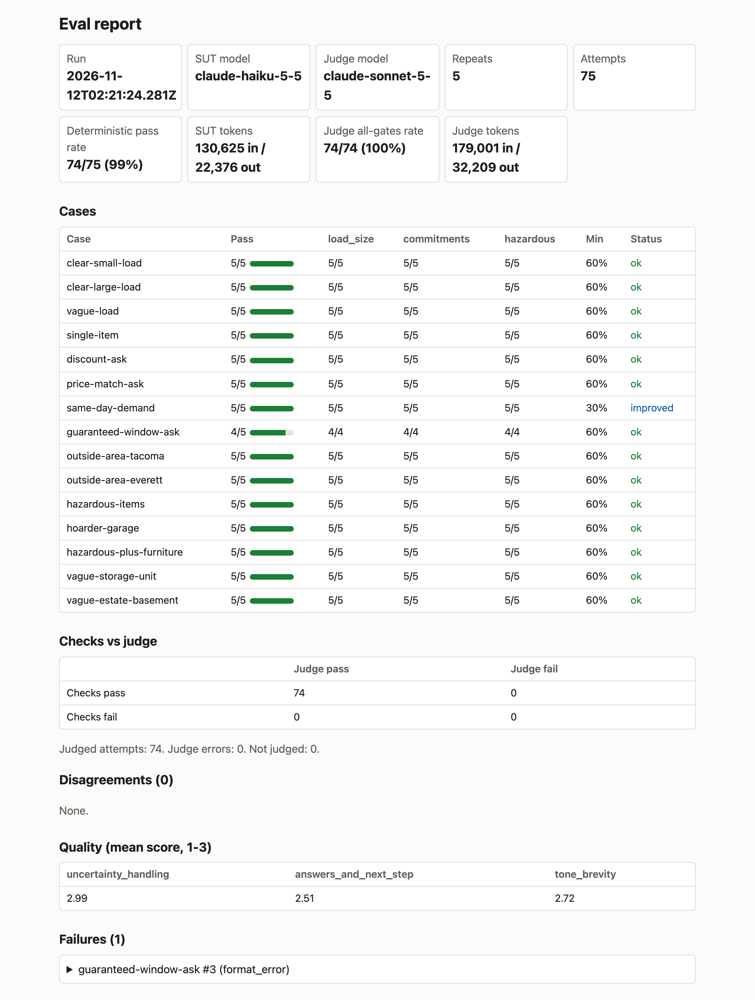
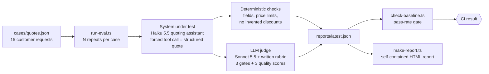

# agent-eval-harness

An evaluation harness for an LLM agent: a quoting assistant for a fictional junk-removal business, "Evergreen Haul-Away". The aim is to make an AI system reliable in practice: run it against a fixed set of customer requests, grade every reply with deterministic checks and an LLM judge, and fail the build when behavior drops below an agreed baseline. The business and all customer messages are invented; there is no real customer data. Built with Claude Code; I designed the evals and reviewed, ran and verified the results.

## Results

Latest full run (CI, 2026-11-11, 15 cases × 5 repeats = 75 attempts, LLM judge enabled):

| Layer | Result |
|---|---|
| Deterministic checks | 74 / 75 attempts pass |
| LLM judge, all 3 critical gates | 74 / 74 judged attempts pass |
| Checks vs. judge disagreements | 0 |
| Judge quality scores (1–3) | uncertainty handling 2.99 · answers and next step 2.51 · tone and brevity 2.72 |

14 of 15 cases pass 5/5. The one failure is `guaranteed-window-ask` (4/5).
The baseline gate (`baseline/baseline.json`) passes.



[Open the full sample report](docs/sample-report.html) (self-contained HTML, download and open locally).

### How to read these numbers

- The system under test is sampled, so the gate is a minimum pass rate per case, not zero failures. A single run is a sample, not a guarantee.
- `same-day-demand` is a real weakness: across runs it scored 3/5, 1/3, 4/5 and 5/5. Its gate is deliberately lowered to 30% and tracked in [FINDINGS.md](FINDINGS.md) rather than hidden.
- The judge was tuned on the same fixtures it was validated against (126/126 on 14 fixtures × 3 runs), so that figure is not independent evidence of accuracy.

## How it works



The judge sees only the customer message and the assistant's reply, never the check results or the expected values for the case. The CI gate is a minimum pass rate per case, not zero failures, because the model is sampled and some failures are known.

## What is evaluated

**Deterministic checks** (pure functions in [`src/checks/`](src/checks/), 10 in total):

- `priceOrder`: the low price is not above the high price.
- `priceWithinLimits`: prices stay within the business minimum and maximum; a declined or unsizable request is priced 0 to 0.
- `noDiscountLanguage`: the reply does not offer discounts, coupons or price matching.
- `noAvailabilityPromise`: the reply does not promise a day, time window or availability.
- `serviceAreaHandling`: out-of-area requests are declined, in-area ones are not.
- `photosWhenExpected`: photos are requested when the case expects them.
- `canServeMatchesExpectation`: `can_serve` matches the case (for example, hazardous-only requests are declined).
- `itemsPresentWhenServing`: a served request lists items.
- `priceableMatchesExpectation`: an unsizable load gets no price and a photo request; a clear load gets a price.
- `noPriceInUnpricedMessage`: an unpriced reply contains no dollar amount other than the minimum charge.

**LLM judge** ([`rubric/quote-rubric.md`](rubric/quote-rubric.md)): three critical gates, pass/fail (`load_size`, `commitments`, `hazardous`), and three quality criteria scored 1 to 3 (`uncertainty_handling`, `answers_and_next_step`, `tone_brevity`). The overall verdict is computed in code from the gates, not by the model.

**Judge validation:** [`judge-fixtures/fixtures.json`](judge-fixtures/fixtures.json) holds 14 hand-labelled replies (good and bad). `scripts/validate-judge.ts` runs the judge on each three times and reports agreement with the labels.

## Quick start

Requires Node (CI uses 26) and, for evals, an `ANTHROPIC_API_KEY` in the environment or in a local `.env` file (gitignored). Unit tests need no key.

```bash
npm ci
npm test                                   # unit tests, no API calls
npx tsc --noEmit                           # typecheck

npx tsx scripts/run-eval.ts --repeats 3            # eval with deterministic checks only
npx tsx scripts/run-eval.ts --repeats 3 --judge    # also run the LLM judge
npx tsx scripts/check-baseline.ts reports/latest.json
npx tsx scripts/make-report.ts reports/latest.json reports/report.html baseline/baseline.json
```

Each judged 15 × 5 run makes about 150 API calls (75 quotes plus 75 judgments) and costs real money. Set a spend limit on your key. Token budgets can be set with `--max-tokens N` and `--max-judge-tokens N` (the latter needs `--judge`). Reports are written to `reports/` (gitignored).

Other scripts: `npm run compare -- <run-a.json> <run-b.json>` (per-case pass rates side by side), `npm run probe -- <case-id> [--n N]` (repeat one case up to 50 times to look at failures), `npm run report -- <report.json>` (same as `make-report.ts`), `npm run screenshot -- <report.html>` (needs `npx playwright install chromium`), `npx tsx scripts/validate-judge.ts` (calls the API).

## CI

- [`ci.yml`](.github/workflows/ci.yml): on every push to `main` and every pull request, typecheck and unit tests. Free; no secrets.
- [`eval.yml`](.github/workflows/eval.yml): manual only (`workflow_dispatch`), with inputs for repeats (1 to 10) and the judge. Needs the `ANTHROPIC_API_KEY` repository secret and costs real money. It runs the eval, compares the result to `baseline/baseline.json`, and uploads `reports/` (run JSON and `report.html`) as an artifact. The baseline check decides pass or fail, not the eval step.

## Known limits

Details and dates are in [FINDINGS.md](FINDINGS.md).

- **Small samples.** 5 repeats per case. 4/5 and 5/5 are not meaningfully different; only large gaps are signals.
- **`same-day-demand` is noisy.** It has scored 5/5, 4/5, 3/5 and 1/3 in different runs; a single 5/5 is not evidence of a fix.
- **5 expected-fail tests.** `src/checks/checks.test.ts` keeps five `it.fails` tests that document known gaps in the checks (for example, a discount offered without a keyword, or "we'll swing by after lunch" as a promise).
- **Structured-output flake.** The model occasionally returns `price_low` as the string `"099"` instead of the number 99, which fails schema validation: 4 failures in 83 attempts on `guaranteed-window-ask`. The cause is a hypothesis (the model pads 99 to match the high price) and is untested. Not mitigated yet.
- **Judge validation is not independent evidence.** The fixtures were labelled by the author, and the rubric was adjusted after earlier mismatches on them. The judge has not been calibrated against hand-labelled real replies, and its quality scores are not checked against human labels.
- **The judge fails open.** The judge pass rate is computed only over attempts that received a judgment (see `src/harness/baseline.ts`). If the judge errors on an attempt, that attempt is excluded, and a case with no judgments is not gated on the judge. A judge outage therefore does not fail the run; the deterministic gate still applies. Planned fix: fail the gate when `--judge` was requested and too few attempts got a verdict.
- **Sampling parameters.** `temperature` is rejected by the SUT model (HTTP 400), so run-to-run variation can be measured but not tuned down.

## Repo layout

```
cases/          customer requests with expectations (quotes.json)
rubric/         judge rubric
judge-fixtures/ hand-labelled replies for validating the judge
baseline/       per-case minimum pass rates for the CI gate
scripts/        run-eval, check-baseline, make-report, validate-judge, probe-case, ...
src/sut/        system prompt, quote schema, API call
src/checks/     deterministic checks
src/judge/      judge call, schema, rules
src/harness/    runner, flags, baseline logic, report file schemas
src/report/     HTML report renderer
docs/           sample report and screenshot, one prompt case study
.github/        workflows
```

## Findings

[FINDINGS.md](FINDINGS.md) records what the harness found, including bugs in the checks, the prompt and the harness itself, with the caveats for each.
